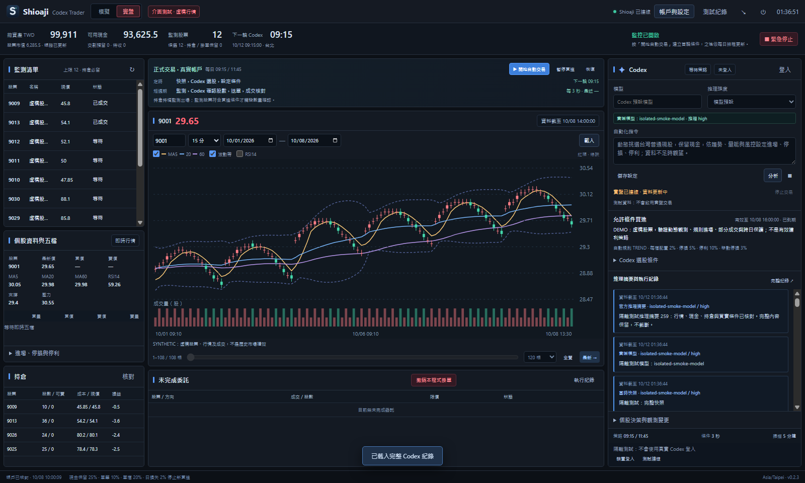

# Shioaji Codex Trader

**目前版本：[v0.1.1 預發行版](https://github.com/jackyname1/shioaji-codex-trader/releases/tag/v0.1.1)** · Windows x64 免安裝

台灣股票桌面工作台：以 Shioaji 取得行情，讓 Codex 設定選股與買賣條件，由程式核對價格、股數、現金及風控。提供即時模擬、歷史回放和實盤帳戶介面；歷史測試使用獨立虛擬帳戶。

## 這版更新

- **修正股票池聯集超過 100 檔就停止。** 每日資料池上限仍可設定為 20–100 檔，整段期間累計出現的股票可以超過 100 檔；每一天保留完整成員及前一交易日排行日期。
- **保留可供指標計算的歷史，減少無需重播的分鐘資料。** 每檔入池前的可用行情整理成每日 OHLC、成交量和成交金額；從首次入池日至回放截止保留可用分鐘行情，離池後仍可監控已持有股票。
- **Codex 故障保留具體原因。** 子程序退出、回合失敗、串流中斷、登入、模型、額度或逾時會保存安全錯誤代碼。執行故障停止後續自動呼叫；完整且有效的連線測試或重新分析才解除故障。未確認數量不送單。
- **更新 README 與 Windows 實際介面截圖。** 截圖來自新版程式的隔離介面測試，使用虛構行情及帳戶資料，不代表實盤或歷史績效。

## Windows 介面

歷史回放：日期、本金、播放時鐘、圖表、每日選股、費稅與成交紀錄集中在同一工作台。


即時模擬：以真實行情與虛擬資金演練策略、條件檢查、股數確認及委託核對。


實盤帳戶及 API／CA 設定：截圖使用隔離資料展示欄位。




完整 Codex 紀錄可搜尋及匯出 JSON，包含快照、正式推理摘要、結構化回覆、用量、核對結果與安全故障代碼。


## 開始使用

1. 從 [v0.1.1 Release](https://github.com/jackyname1/shioaji-codex-trader/releases/tag/v0.1.1) 下載 `Shioaji-Codex-Trader-0.1.1-Windows-x64.exe`。先從舊程式系統匣選擇「結束程式」，再開啟新版；單一執行個體機制會把再次啟動導回仍執行中的舊版本。右下角可核對實際版本。
2. 按右上角「帳戶與設定」，輸入 API Key、Secret Key，再按「登入並記住」。實盤下單另需有效 CA 憑證及密碼。登入與設定共用於模擬和實盤。
3. 按右側 Codex「登入」，完成官方瀏覽器登入並按「測試連線」。模型留空時解析帳戶預設模型；畫面顯示實際模型及推理強度。
4. 在「模擬 → 即時模擬」演練目前行情。要使用過去行情，切到「歷史回放」，設定起訖日期、時刻、本金及排程，再開始「Codex 每日選股」。
5. 「實盤」顯示真實帳戶及委託；按「開始自動交易」才啟動策略。重啟、重新連線及解除 Codex 故障都不會自行解除停止狀態或繞過交易風控。

## 歷史回放怎麼運作

| 階段 | 行為 |
|---|---|
| 每日股票池 | 使用前一交易日的歷史成交金額排行，保留當日實際合格成員，上限可設定為 20–100 檔；累計聯集可超過 100 檔。也可指定最多 100 檔固定股票。 |
| 指標暖機 | 入池前的行情整理成每日 OHLCV 與成交金額，計算 MA、RSI、ATR 等。模型及指標只讀取虛擬時間之前的已完成日 K。 |
| 策略 | 在設定時間呼叫 Codex，選出合格候選及監測條件。目標監測 5–20 檔；沒有合格股可以保留現金。 |
| 條件監測 | 歷史 Codex 回放每五分鐘檢查條件及更新監測清單；分鐘行情核對既有委託。 |
| 股數與風控 | 條件觸發後另建最新模擬帳戶快照，詢問 Codex 實際股數，再核對現金、可賣庫存、費稅及價格。 |
| 播放控制 | 「直達觸發點」依序處理事件；「加速播放」支援 1–60 倍。暫停、分析及股數確認期間凍結虛擬時間。 |
| 故障與結果 | 執行故障保存 PARTIAL 結果並停止後續模型呼叫；不以未完成期間的結果冒充完整回測。 |
| 匯出 | 完整 JSON 包含已保存分鐘行情、暖機日 K、每日股票池及入池日期；CSV 僅含保留的分鐘行情與成交金額。成交明細另有 CSV。 |

日期最多 367 天；分鐘行情及暖機日 K 合計最多 300 萬筆。超過資料量上限會明確停止，需分段回測；每日排行不會因此被截斷。歷史下載維持每次最多 30 個日曆日、快取及節流。

日 K 圖可查看暖機資料；分鐘圖顯示每檔入池後保留的分鐘行情。歷史零股五檔、排隊、滑價及企業行動仍有近似限制，策略小樣本與虛構測試結果都不能當作實盤獲利證明。

## 連線與停止

登入 Shioaji 後，行情、餘額、交割、持倉與委託分別核對；單項失敗保留最後成功資料，但資料不完整或價格過期時不送單。歷史模擬不讀取實盤銀行餘額及個人持倉。

Codex 中斷時查看「完整紀錄」的錯誤代碼；修復連線後按「測試連線」。歷史測試需要重新開始；日策略失敗時需重新分析。暫停買進、緊急停止與實盤限制保持原狀。

「停止交易」阻止新委託，既有券商掛單需另外處理；保留停損條件不保證網路中斷時能成交。Windows 發行者驗證需可信程式碼簽章；未配置憑證時會如實標記未簽章，詳見 [Windows 簽章](docs/WINDOWS_SIGNING.md)。

## 開發

```bash
npm ci
npm test
npm start
npm run pack:win
```

需要 Node.js 24 以上。開發與打包會取得並驗證官方 Shioaji；程式資料保存在本機使用者資料目錄。單元測試、隔離原生 Codex 測試及 Windows 來源／成品介面驗證完成後才發布。

[操作與資料限制](docs/OPERATIONS.md) · [更新紀錄](docs/RELEASE_NOTES.md) · [Shioaji 官方文件](https://sinotrade.github.io/) · [Shioaji Pro](https://github.com/Sinotrade/shioaji-pro-app)
