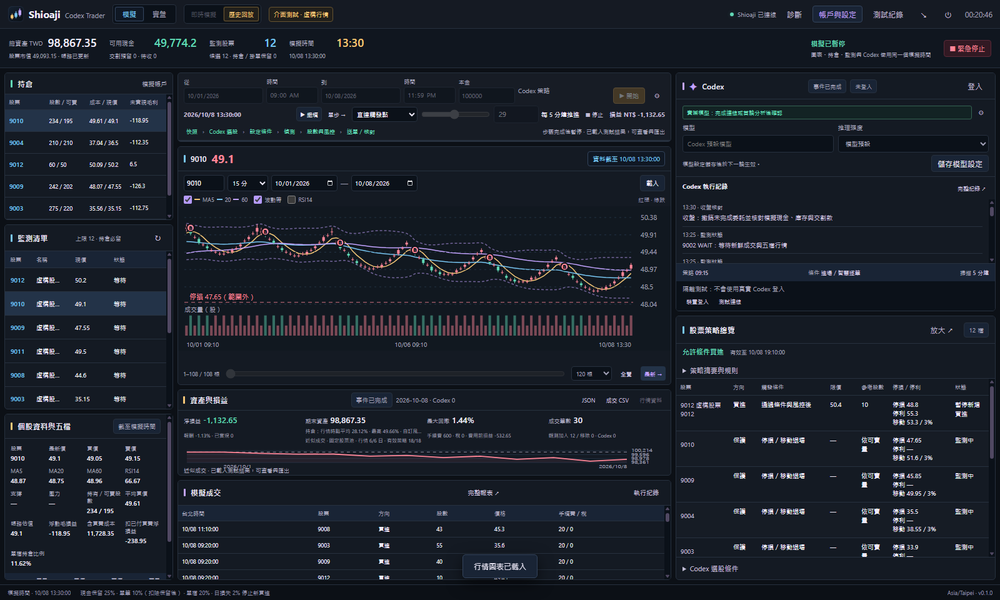
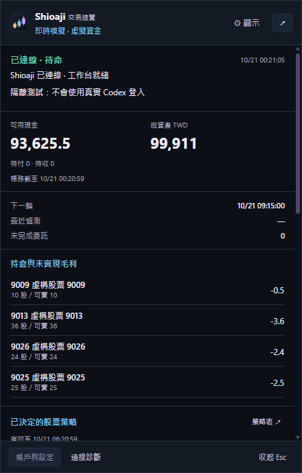
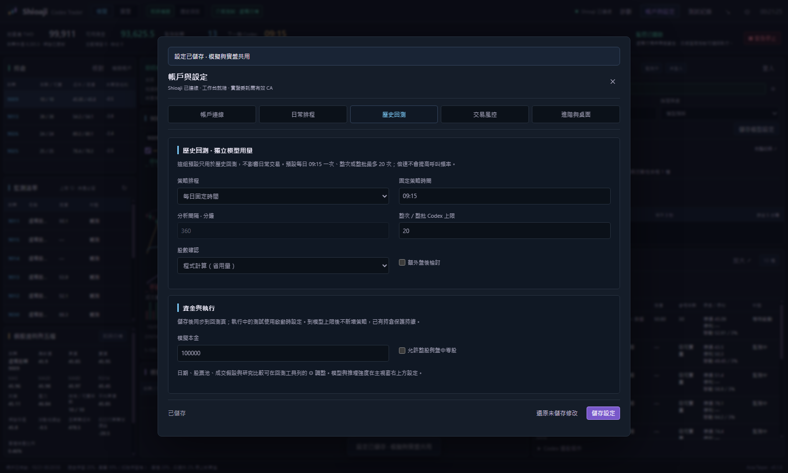
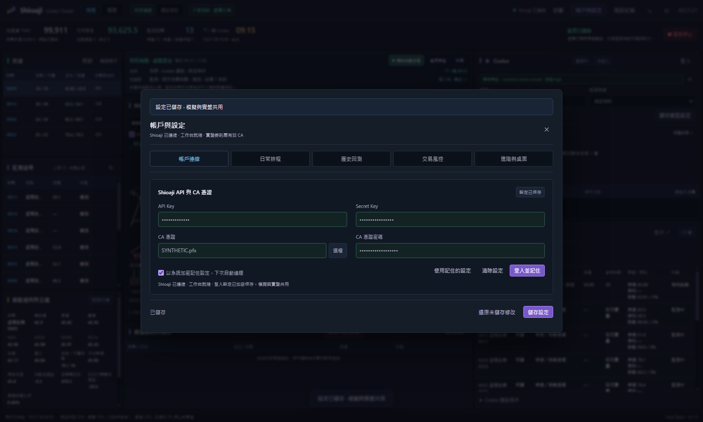

# Shioaji Codex Trader

**[v0.1.0 預發行版](https://github.com/jackyname1/shioaji-codex-trader/releases/tag/v0.1.0)** · Windows x64 免安裝

台灣股票桌面工作台。Shioaji 提供行情與帳務，Codex 設定股票策略，由程式逐筆核算股數、費稅、庫存及風控。提供即時模擬、歷史回測與實盤介面；啟動預設模擬模式，自動交易關閉。

## 下載與開始

1. 下載 [Shioaji-Codex-Trader-0.1.0-Windows-x64.exe](https://github.com/jackyname1/shioaji-codex-trader/releases/download/v0.1.0/Shioaji-Codex-Trader-0.1.0-Windows-x64.exe)。先結束舊程式，再開新版；右下角可核對版本。
2. 開啟「帳戶與設定 → 帳戶連線」，輸入 API Key、Secret Key。實盤需要有效 CA 憑證及密碼；記住設定時使用系統加密保存。
3. 在右側 Codex 控制台登入並測試連線。模型及推理強度可直接修改，儲存後於下一輪生效；留空使用帳戶預設模型。
4. 先使用「模擬 → 即時模擬」或「歷史回放」。日常排程與回測用量各自設定、各自保存。
5. 切換實盤後核對帳戶，再按「開始自動交易」啟動。重啟與故障恢復不會自動解除停止狀態。

## 工作台

- 左側集中持倉、監測清單、個股及五檔；點股票可連動主圖。
- 右上直接設定模型與推理強度，下方顯示簡要 Codex 執行紀錄；完整紀錄可搜尋、匯出。
- 右下獨立「股票策略總覽」以表格顯示方向、觸發、限價、參考股數、停損／停利及狀態，可放大查看。
- 單擊系統匣開啟速覽：**基本資料 → 持倉 → 策略 → 監測 → 委託**。支援顯示區塊、隱藏金額及點選股票。
- 設定頁分成帳戶連線、日常排程、歷史回測、交易風控及進階與桌面。





## 兩組 Codex 設定

| 設定 | 日常交易 | 歷史回測 |
|---|---|---|
| 預設排程 | 每日 09:15、11:45 | 每個回測交易日 09:15 |
| 用量上限 | 每日 2 次 | 整次／整批比較合計 20 次 |
| 股數核算 | 程式計算 | 程式計算 |
| 額外盤後檢討 | 關閉 | 關閉 |
| 修改入口 | 帳戶與設定 → 日常排程 | 帳戶與設定 → 歷史回測，或回測工具列 ⚙ |

啟動、手動分析、失敗嘗試與額外股數模型均計入對應策略上限。登入測試另外使用少量模型用量。行情更新、條件偵測及持倉保護不呼叫模型；到上限後不新增策略，持倉保護持續。回放倍速不增加模型頻率。執行中的回測固定使用啟動時設定，修改預設供後續測試使用。





截圖均來自本版 Windows 隔離測試，使用合成資料。[截圖來源與雜湊](docs/screenshots/provenance.json)

## 資金與保護

| 項目 | 強制界線 |
|---|---|
| 保留現金 | 至少 25% |
| 單筆本金 | 扣除保留現金後資金的 10% 以內 |
| 單檔／總持倉 | 總資產 20%／75% 以內 |
| 每日新增買進 | 總資產 20% 以內、最多 5 筆，包含掛單 |
| 當日損失 | 達 2% 停止新買進 |

較嚴格設定保留。程式核對行情有效期、帳務、掛單、可賣庫存及費稅，模型與回測配置不能放寬以上界線。賣款依已確認交割日 T+2 上午 11:00 成為可用現金；今日新增零股不可當日賣出。

固定停損優先，ATR 移動保護與費稅保本底線只升不降；收益目標本身不觸發賣出。跳空、無流動性或斷線仍可能無法按保護價成交。三策略並行、動態配置及組合研究功能預設關閉；未證實提高樣本外收益，研究風險與選股開關禁止套用實盤。

## 歷史資料與結果

使用前一交易日歷史排行建立每日股票池，模型與指標只讀取虛擬時間前已完成的資料。一般進場與持倉保護依可用分鐘行情逐筆檢查；新委託最早在後續行情成交。

- 日期最多 **367 天**；分鐘行情與暖機日 K 合計最多 **300 萬筆**，超量需分段。
- 歷史下載每次最多 **30 個日曆日**，使用快取與節流。
- 股票池每日 20–100 檔，跨日聯集可超過 100 檔；也可指定最多 100 檔固定股票。
- 匯出完整 JSON、成交 CSV 與行情資料。故障保留 PARTIAL 結果及停止時刻，不算作完整回測。
- 歷史零股五檔、排隊、企業行動及滑價存在近似；分鐘收盤價不能重建 K 線內路徑。測試畫面與小樣本結果不能當作實盤獲利證明。

## 開發與驗證

```bash
npm ci
npm test
npm start
npm run pack:win
```

需要 Node.js 24 以上，內建官方 Shioaji。發行前執行 Linux／Windows 測試、Windows 來源與封裝 GUI 驗證，核對發布資產及 SHA-256。使用者資料、金鑰、憑證及帳務不進入版本庫。版本重新編為 0.1.0 不會清除本機資料。

[設定參數](docs/SETTINGS.md) · [操作說明](docs/OPERATIONS.md) · [版本說明](docs/RELEASE_NOTES.md) · [Windows 簽章](docs/WINDOWS_SIGNING.md) · [Shioaji 官方文件](https://sinotrade.github.io/)
