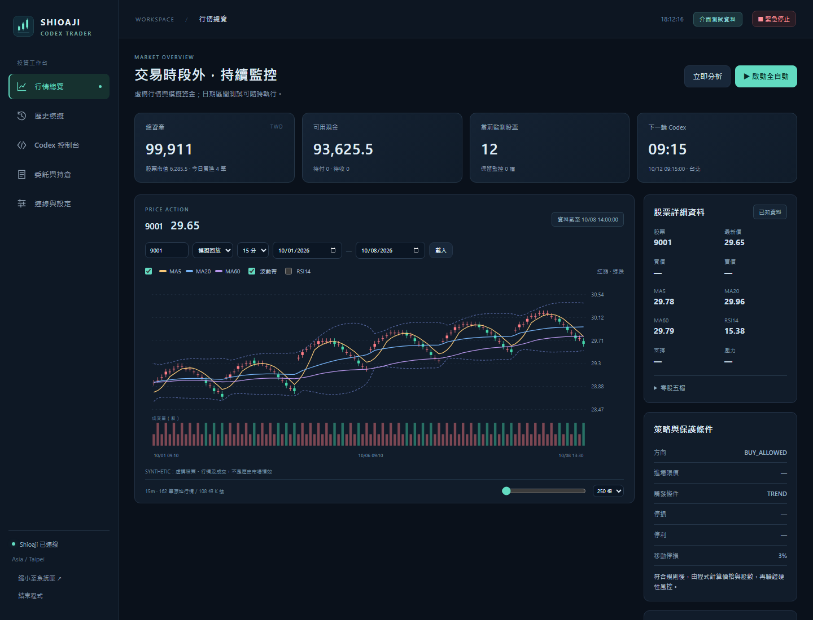
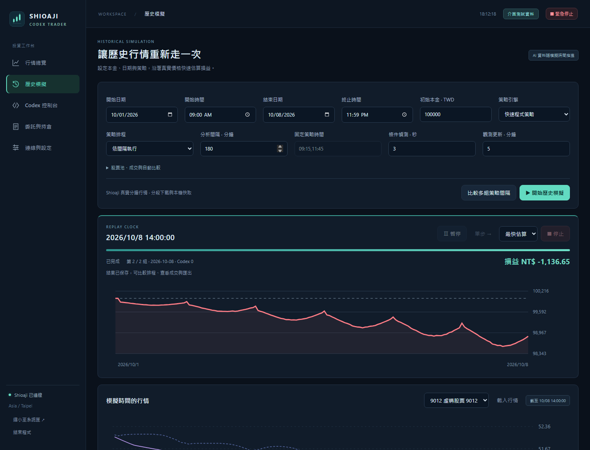
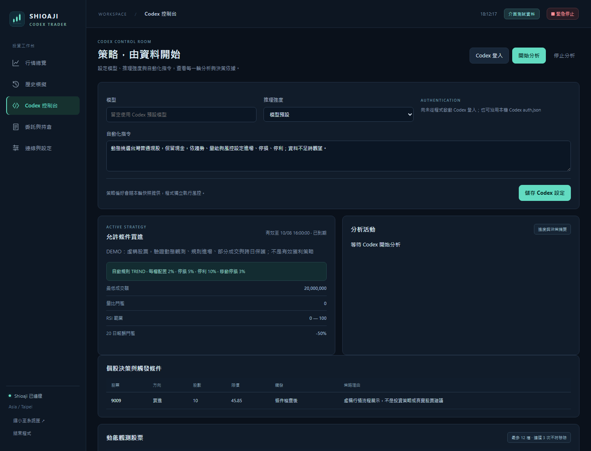
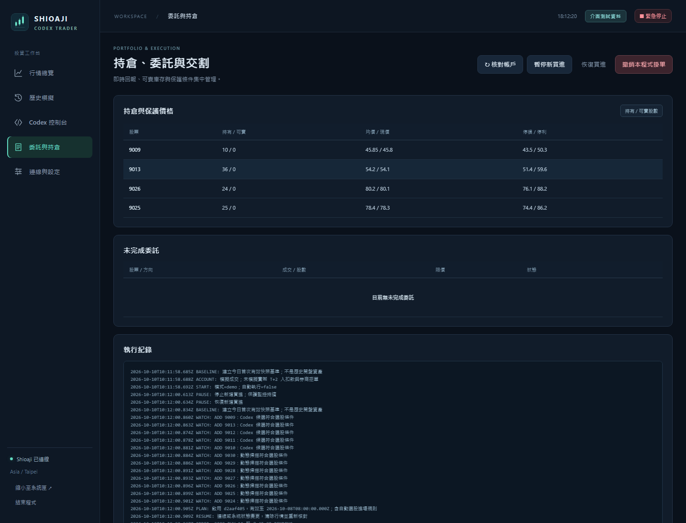
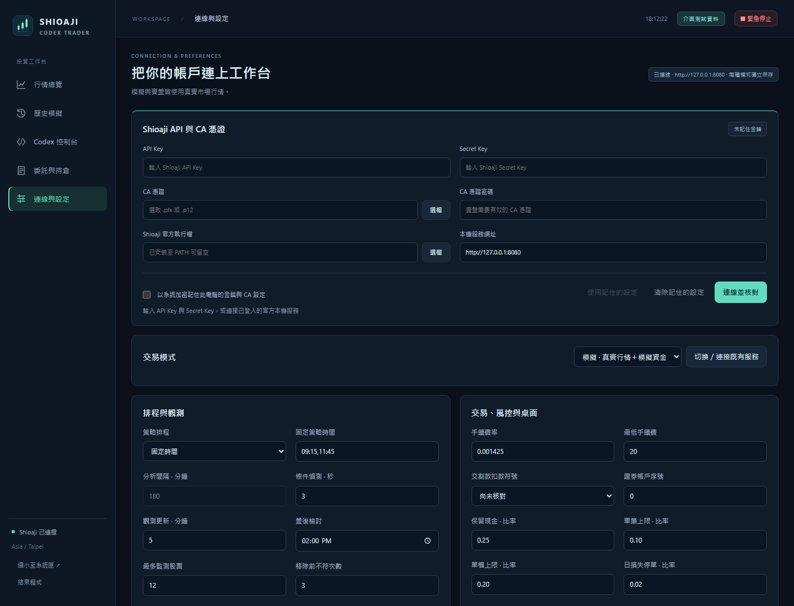

# Shioaji Codex Trader

把 Shioaji 真實行情、Codex 動態策略與歷史模擬整合在同一個桌面工作台。設定 API 與 CA 憑證後，即可觀察股票、快速估算歷史損益，或啟用現股自動交易。



## 功能

| 功能 | 說明 |
|---|---|
| API 與憑證 | 直接輸入 API Key、Secret Key，選取 CA 檔案；可使用系統加密記住設定，或連接既有 Shioaji 本機服務。 |
| 兩種模式 | **模擬**使用真實股價與模擬資金；**實盤**使用真實帳戶。兩者都需要有效的 Shioaji API 連線。 |
| 行情圖表 | 分鐘、5／15／60 分與日 K，即時五檔，搭配 MA5／20／60、波動帶、RSI、成交量、保護價格和模擬成交標記；可調整日期與時間軸。 |
| 歷史模擬 | 指定起訖日期、時刻和本金，終止時間最晚到現在；歷史行情分段下載、快取並保存，可匯出完整資料。 |
| 回放控制 | 暫停、繼續、單步與 1×～3000× 加速；最快估算模式可迅速跑完整個區間。 |
| 策略比較 | 快速程式策略或 Codex 逐輪分析；同一段資料可比較不同分析間隔，查看損益、資產曲線、回撤、費稅及成交紀錄。 |
| Codex 控制台 | 登入 Codex、選擇模型及推理強度、編輯自動化指令，查看分析進度、決策摘要與選股條件。 |
| 動態監測 | 自動更新 5–20 檔觀測股，顯示進場、停損、停利、移動停損與判斷原因；持倉及掛單持續保留監控。 |
| 交易管理 | 現股、盤中零股與整股限價單，委託／成交回報、可賣庫存、交割款、智慧保護、帳戶核對與撤單。 |
| 桌面操作 | 深色工作台、專屬工作列與系統匣圖示、背景監控、暫停買進、緊急停止及本機紀錄保存。 |

實盤顯示截至現在的行情；模擬中的 AI、指標與觀測清單只使用截至當下模擬時間的資料。

## 開始使用

1. 從 [Releases](https://github.com/jackyname1/shioaji-codex-trader/releases) 下載 Windows 程式並開啟。
2. 安裝 [Shioaji 官方本機服務](https://sinotrade.github.io/env_setup/other/)，在「連線與設定」填入 API Key、Secret Key，選取 CA 憑證及官方執行檔。
3. 設定專用的本機服務網址，按「連線並核對」。如果服務已登入，使用「連接既有服務」。
4. 在「歷史模擬」輸入日期與本金，使用快速程式策略開始測試；需要 AI 逐輪判斷時，在 Codex 控制台登入並儲存設定。
5. 使用實盤前核對帳戶、費率、交割款與 CA，再完成本機授權並啟動自動交易。


[查看完整損益與成交畫面](docs/screenshots/simulation-results.png)





## 開發

```bash
npm ci
npm test
npm start
npm run pack:win
```

需要 Node.js 24 以上。設定與報表保存在本機使用者資料目錄，無需固定自選股或 `config.yaml`。

[連線、模擬與資料說明](docs/OPERATIONS.md) · [版本更新](docs/RELEASE_NOTES.md) · [Shioaji 官方文件](https://sinotrade.github.io/) · [Shioaji Pro](https://github.com/Sinotrade/shioaji-pro-app)
