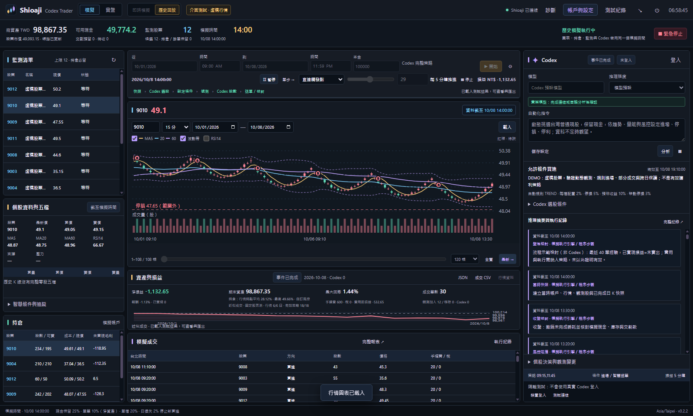
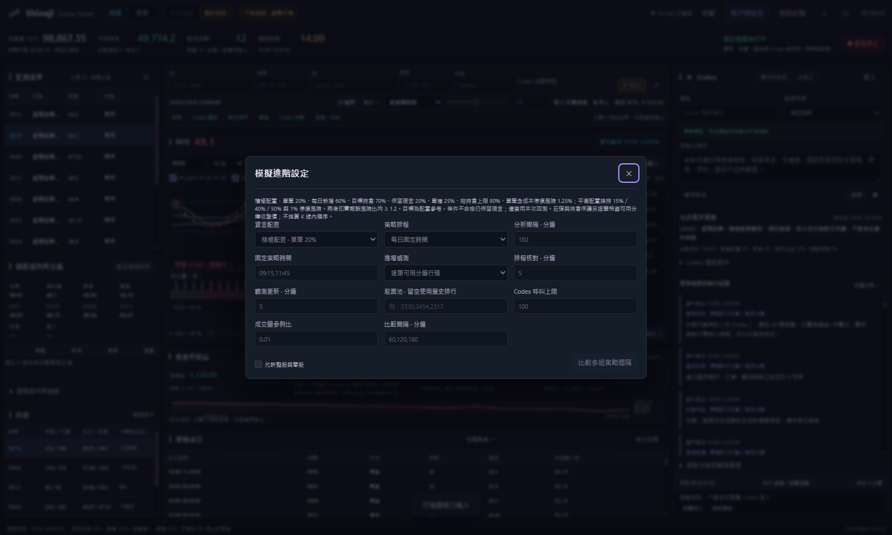
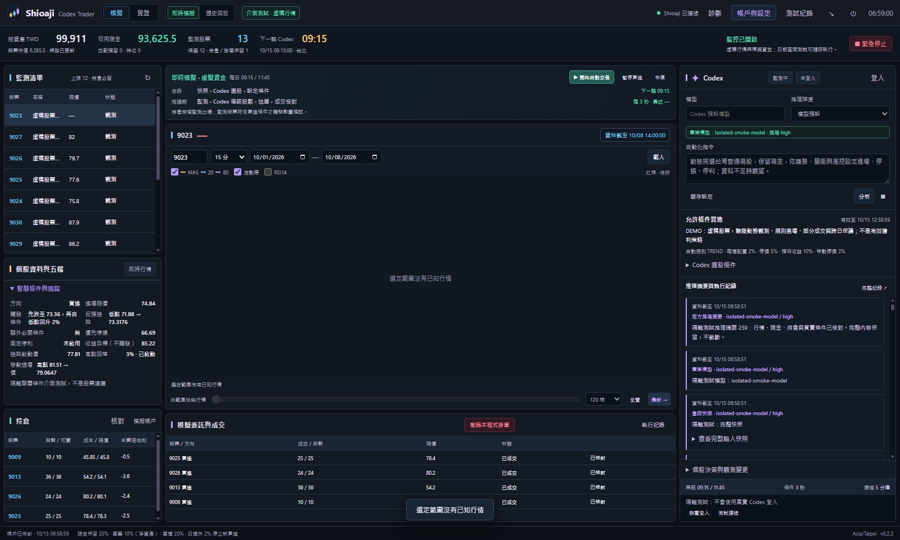
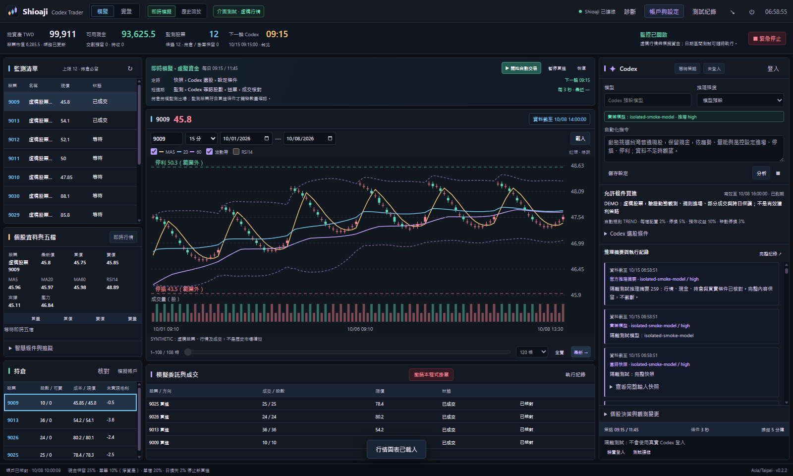
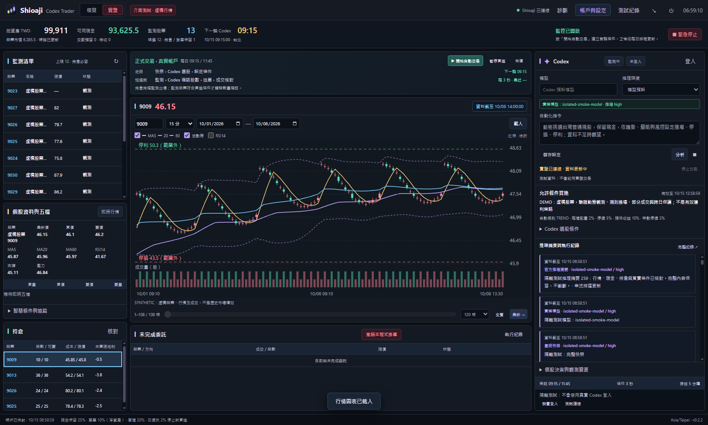
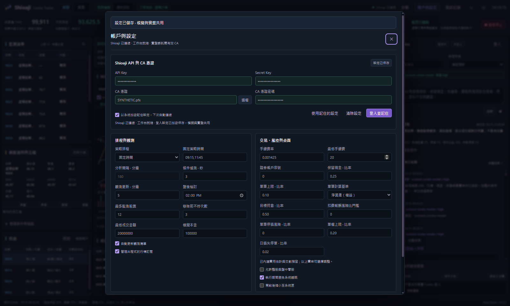
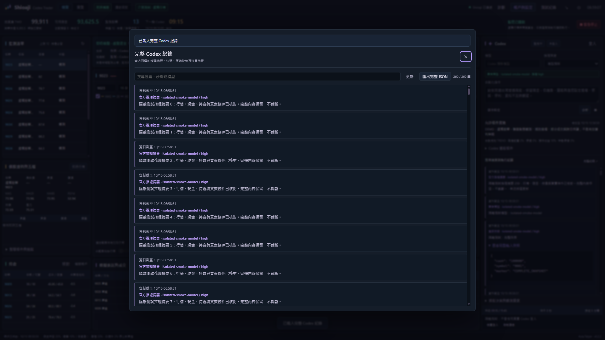

# Shioaji Codex Trader

**目前版本：[v0.2.2 預發行版](https://github.com/jackyname1/shioaji-codex-trader/releases/tag/v0.2.2)** · Windows x64 免安裝

**v0.2.3 候選版：[PR #26](https://github.com/jackyname1/shioaji-codex-trader/pull/26)**。已完成程式修改、本地回歸、原始紀錄核帳及 17 組同資料比較；尚未發布。樣本外結果不支持預設啟用三策略與動態配置，故保留為研究選項，預設使用原趨勢進場、原配置與智慧保護。GitHub runner 尚未啟動，Windows 來源、封裝與實際 GUI 截圖待驗收。完整數據、限制與重現方法見 [v0.2.3 驗證報告](docs/V0.2.3_VALIDATION.md)。以下下載與截圖仍對應已發布的 v0.2.2。

台灣股票桌面工作台：以 Shioaji 取得行情，讓 Codex 設定選股與買賣條件，由程式核對價格、股數、現金及風控。提供即時模擬、歷史回放和實盤帳戶介面；歷史測試使用獨立虛擬帳戶。

## 這版更新

- **積極回測配置與分鐘買點。** 預設單筆權益 20%、每日新增 60%、軟性持倉目標 70%；一般進場可逐筆檢查可用分鐘行情，減少五分鐘網格錯過短暫買點。資金、費用與停損風險仍需通過。
- **修正無法成立的價格條件。** 檢查觸發、LAST 指標條件、買價上限及 tick 的交集，空區間不進行數量確認；窄區間會納入診斷，不自行抬高買價。
- **模型取得當前報價與執行回饋。** 僅提供新鮮且不晚於決策時間的成交／買賣報價，以及上一輪區間和未進場原因；要求比較趨勢、突破、反彈及固定／移動退場，不只重複等待回檔。
- **持倉點選修復。** 點股票或整列、按 Enter／空白鍵可切換主圖與智慧條件；選中股票同步反白，載入時清除上一檔圖表。監測與決策表也可切換股票，回放圖表仍受虛擬時間限制。
- **完整報表新增進場診斷。** 可查看提案數、反彈／移動保護使用率、無交集與窄區間、至少部分成交及完全未成交買單，以及等待原因樣本。持倉損益標示為未實現毛利；頁尾顯示本次回測實際風控。
- 每日股票池聯集可超過 100 檔；完整排行、暖機、費稅、零股可賣限制與下一價格事件撮合保留。README 截圖來自本版實際 Windows 隔離測試。

使用者提供的 0.2.1 紀錄：20 個交易日，54 個買進提案、7 筆買單、5 筆至少成交一股；策略快照平均持倉約 14.8%，淨損益 790.5 元。43 個提案只等跌破、6 個突破僅留一個價位，另有相互衝突的進場條件，且未採用移動退場。詳見[測試分析與驗證](docs/V0.2.2_VALIDATION.md)。這份執行紀錄缺少完整分鐘行情，因此新版改善尚未以同一真實價格路徑重跑確認。

## Windows 介面

截圖版本與擷取來源見[截圖紀錄](docs/screenshots/provenance.json)。

歷史回放：日期、本金、播放時鐘、圖表、每日選股、費稅與成交紀錄集中在同一工作台；點選持倉後主圖和選中列同步。



回測資金配置：積極／平衡／自訂配置、進場偵測頻率、計算基準與成本門檻可直接查看。



智慧條件：展開個股的「智慧條件與追蹤」，優先顯示反彈低點、移動高點及觸發價；收合後恢復五檔資訊。收益目標不是賣出指令。



即時模擬：以真實行情與虛擬資金演練策略、條件檢查、股數確認及委託核對。



實盤帳戶及 API／CA 設定：截圖使用隔離資料展示欄位。




完整 Codex 紀錄可搜尋及匯出 JSON，包含快照、正式推理摘要、結構化回覆、用量、核對結果與安全故障代碼。



## 開始使用

1. 從 [v0.2.2 Release](https://github.com/jackyname1/shioaji-codex-trader/releases/tag/v0.2.2) 下載 `Shioaji-Codex-Trader-0.2.2-Windows-x64.exe`。先從舊程式系統匣選擇「結束程式」，再開啟新版；單一執行個體機制會把再次啟動導回仍執行中的舊版本。右下角可核對實際版本。
2. 按右上角「帳戶與設定」，輸入 API Key、Secret Key，再按「登入並記住」。實盤下單另需有效 CA 憑證及密碼。登入與設定共用於模擬和實盤。
3. 按右側 Codex「登入」，完成官方瀏覽器登入並按「測試連線」。模型留空時解析帳戶預設模型；畫面顯示實際模型及推理強度。
4. 在「模擬 → 即時模擬」演練目前行情。要使用過去行情，切到「歷史回放」，設定起訖日期、時刻、本金及排程，再開始「Codex 每日選股」。
5. 「實盤」顯示真實帳戶及委託；按「開始自動交易」才啟動策略。重啟、重新連線及解除 Codex 故障都不會自行解除停止狀態或繞過交易風控。

## 歷史回放怎麼運作

| 階段 | 行為 |
|---|---|
| 每日股票池 | 使用前一交易日的歷史成交金額排行，保留當日實際合格成員，上限可設定為 20–100 檔；累計聯集可超過 100 檔。也可指定最多 100 檔固定股票。 |
| 指標暖機 | 入池前的行情整理成每日 OHLCV 與成交金額，計算 MA、RSI、ATR 等。模型及指標只讀取虛擬時間之前的已完成日 K。 |
| 策略 | 在設定時間呼叫 Codex，選出合格候選及監測條件。目標監測 5–20 檔；沒有合格股可以保留現金。 |
| 條件監測 | 預設一般進場也逐筆檢查可用價格事件，可切回五分鐘排程；股票池每五分鐘更新，反彈與持倉保護逐筆檢查。 |
| 股數與風控 | 條件觸發後另建最新模擬帳戶快照，詢問 Codex 實際股數，再核對現金、可賣庫存、費稅及價格。 |
| 播放控制 | 「直達觸發點」依序處理事件；「加速播放」支援 1–60 倍。暫停、分析及股數確認期間凍結虛擬時間。 |
| 故障與結果 | 執行故障保存 PARTIAL 結果並停止後續模型呼叫；不以未完成期間的結果冒充完整回測。 |
| 匯出 | 完整 JSON 包含已保存分鐘行情、暖機日 K、每日股票池及入池日期；CSV 僅含保留的分鐘行情與成交金額。成交明細另有 CSV。 |

日期最多 367 天；分鐘行情及暖機日 K 合計最多 300 萬筆。超過資料量上限會明確停止，需分段回測；每日排行不會因此被截斷。歷史下載維持每次最多 30 個日曆日、快取及節流。

日 K 圖可查看暖機資料；分鐘圖顯示每檔入池後保留的分鐘行情。歷史零股五檔、排隊、滑價及企業行動仍有近似限制，策略小樣本與虛構測試結果都不能當作實盤獲利證明。

## 反彈買進與智慧退場

條件由 Codex 根據當時資料設計，可在策略指示中要求「回檔後反彈再買、移動退場搭配固定停損」。以下只是機制示例，不是股票建議。

| 條件 | 設定與例子 | 程式行為 |
|---|---|---|
| 反彈買進 | REBOUND、門檻 100、回升 2% | 先跌至 100 才追蹤；低點降至 96，回升至 97.92 才提案，仍受買價上限和 AND 條件約束 |
| 移動退場 | 啟動 110、回落 3%、固定停利未啟用 | 越過 110 不直接賣；高點 115 後跌至 111.55 才提案 |
| 固定停損 | 停損 95 | 價格到 95 或以下優先提案，不等反彈；跳空仍按可用價格與限價風控核對 |
| 收益目標 | reward_target=115 | 僅估算費用後收益／風險，不觸發賣出；若也設固定停利，成本採兩者較低值 |

追蹤只使用新鮮且不超過現在的已觀測成交價；舊行情不啟動新策略，重啟保留當輪低點，整股與零股分開追蹤。既有持倉的停損與已啟動移動保護不放鬆，空倉的新部位不沿用已賣出部位的舊高點。

分鐘回放只使用每筆收盤價，不假設 K 線內的價格路徑；只有日 K 時無法驗證盤中智慧條件。今日買進零股不可當沖，停損、移動退場及觸發價均不保證成交。歷史保護無需額外 Codex 股數確認，但行情／帳務失效、模型故障停止、緊急停止及既有委託核對仍會阻擋送單；即時模式仍先確認股數。

## 資金配置與成本

在歷史回放的「⚙ 模擬進階設定」選擇配置。新介面預設積極配置及逐筆可用分鐘行情；平衡配置和五分鐘排程可用於比較。配置僅套用本次虛擬帳戶，原帳戶設定保留。

| 參數 | 積極配置 | 平衡配置 |
|---|---|---|
| 單筆本金上限 | 權益 20%（十萬元為 20,000 元） | 權益 15% |
| 每日新增買進／筆數 | 權益 60%／8 筆 | 權益 40%／沿用設定 |
| 目標持倉 | 權益 70%，不強制買滿 | 權益 50% |
| 現金保留 | 權益 20% | 沿用設定，初始 25% |
| 單檔／總持倉上限 | 權益 25%／80% | 沿用設定，初始 20%／75% |
| 估計單筆停損風險 | 權益 1.25%，含買賣費稅 | 權益 1%，含買賣費稅 |
| 扣費報酬風險比 | 至少 1.2 | 至少 1.2 |
| 觀測股上限 | 16 檔，持倉持續監測 | 沿用設定，初始 12 檔 |

積極配置仍沿用日損失、行情新鮮度、商品資格與費率；跳空及未成交可能使實際損失超過估計。逐筆模式只使用資料中已存在的收盤價格事件，沒有插值、未來 K 棒或額外自動提高 Codex 呼叫上限；觸發更多交易可能增加股數確認呼叫。

「目前自訂風控」沿用儲存參數。舊版單筆 10%／現金保留 25% 的設定仍按扣除保留後計算，十萬元有效單筆上限為 7,500 元；在帳戶設定可明確切換計算基準。報酬風險比或單筆停損風險填 0 表示未啟用該檢查。變更實盤風控仍會停止既有自動交易授權。

資金目標不保證會投入到指定比例，也不保證獲利；訊號不足、成本不利或資料過期會保留現金。相同訊號與上漲路徑的隔離測試，平衡／積極最高持倉為 41.16%／61.13%，淨損益為 1,865.95／2,805.75 元；這僅驗證程式配置與計算，不能宣稱提高真實歷史或實盤報酬。

## 連線與停止

登入 Shioaji 後，行情、餘額、交割、持倉與委託分別核對；單項失敗保留最後成功資料，但資料不完整或價格過期時不送單。歷史模擬不讀取實盤銀行餘額及個人持倉。

Codex 中斷時查看「完整紀錄」的錯誤代碼；修復連線後按「測試連線」。歷史測試需要重新開始；日策略失敗時需重新分析。暫停買進、緊急停止與實盤限制保持原狀。

「停止交易」阻止新委託，既有券商掛單需另外處理；保留停損條件不保證網路中斷時能成交。Windows 發行者驗證需可信程式碼簽章；未配置憑證時會如實標記未簽章，詳見 [Windows 簽章](docs/WINDOWS_SIGNING.md)。

## 開發

```bash
npm ci
npm test
npm start
npm run pack:win
```

需要 Node.js 24 以上。開發與打包會取得並驗證官方 Shioaji；程式資料保存在本機使用者資料目錄。單元測試、隔離原生 Codex 測試及 Windows 來源／成品介面驗證完成後才發布。

[操作與資料限制](docs/OPERATIONS.md) · [更新紀錄](docs/RELEASE_NOTES.md) · [Shioaji 官方文件](https://sinotrade.github.io/) · [Shioaji Pro](https://github.com/Sinotrade/shioaji-pro-app)
