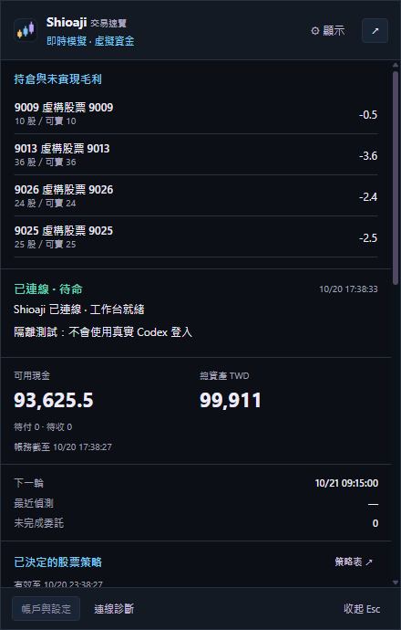
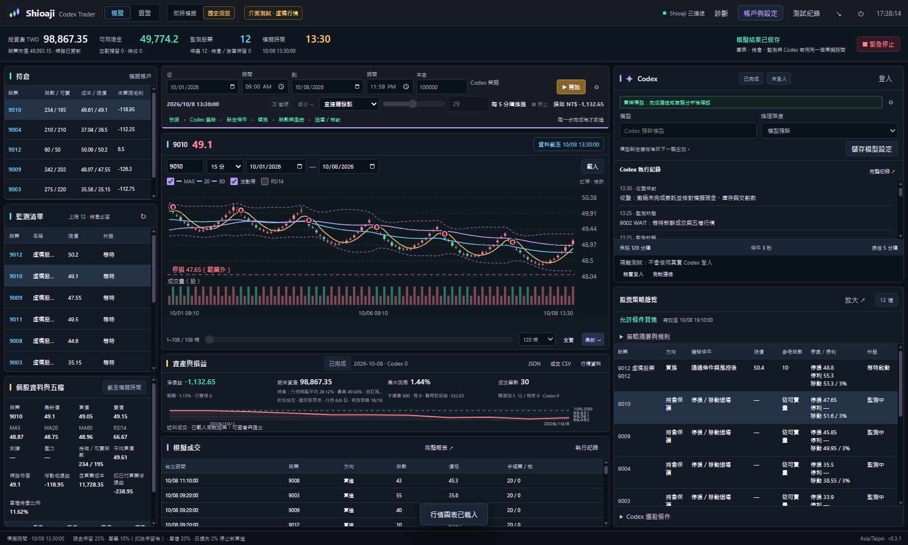
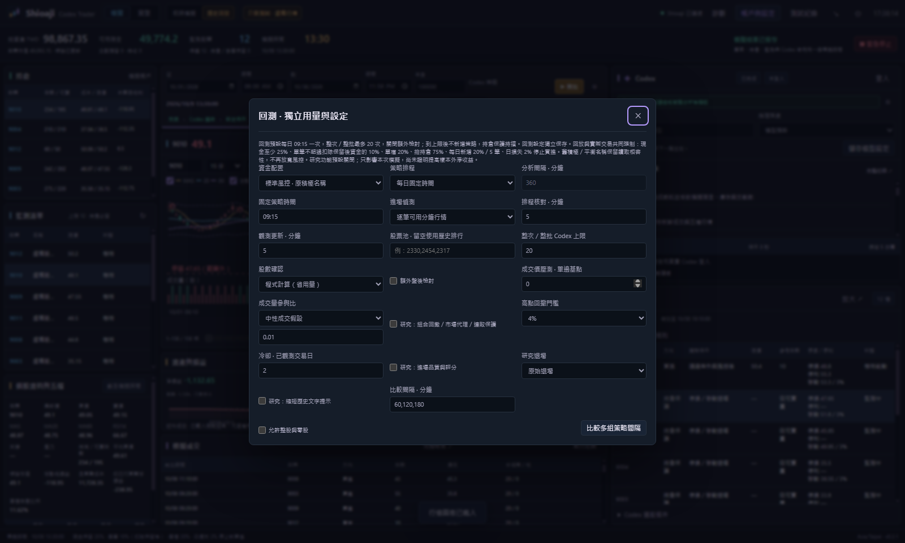
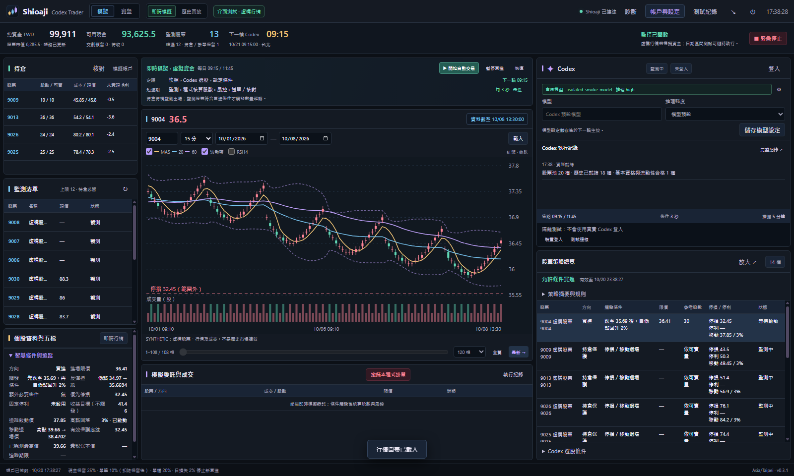
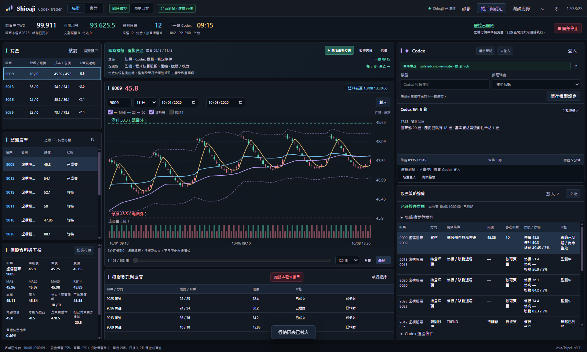
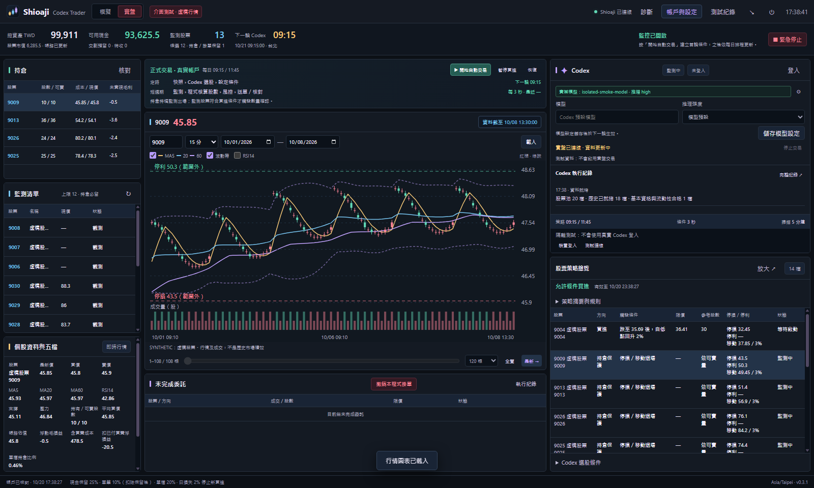
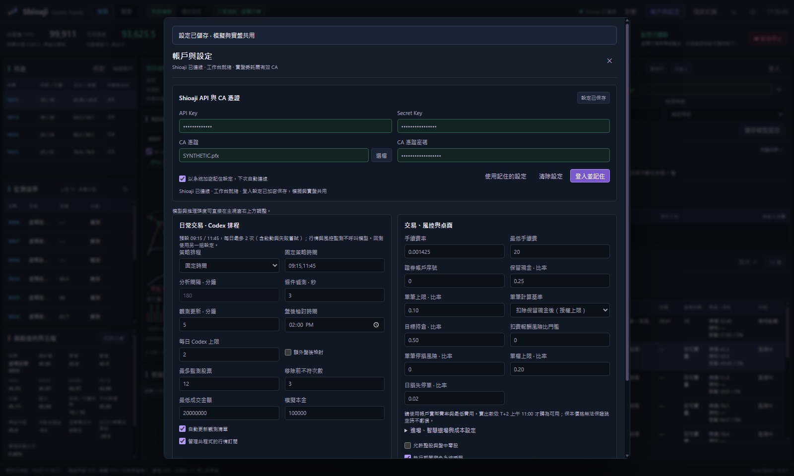
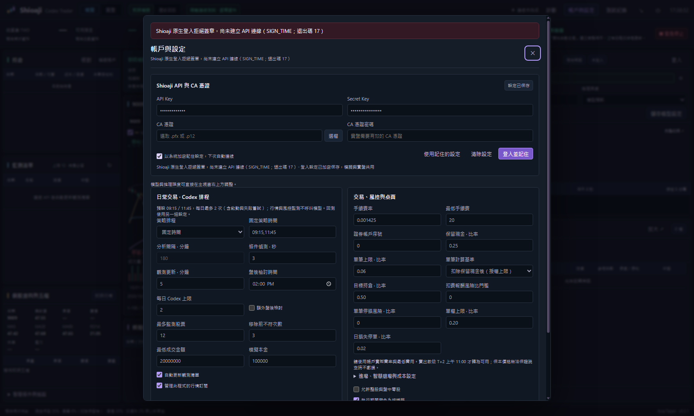
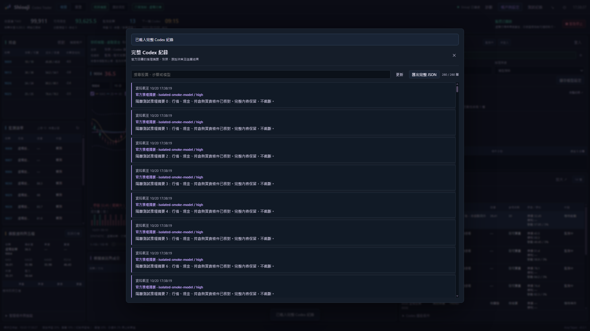

# Shioaji Codex Trader

**目前版本：[v0.3.1 預發行版](https://github.com/jackyname1/shioaji-codex-trader/releases/tag/v0.3.1)** · Windows x64 免安裝

台灣股票桌面工作台：以 Shioaji 取得行情，讓 Codex 設定選股與買賣條件，由程式核對價格、股數、現金及風控。提供即時模擬、歷史回放和實盤帳戶介面；歷史測試使用獨立虛擬帳戶。新版啟動維持模擬模式、自動執行關閉。

## 這版更新

- **兩組獨立 Codex 用量設定。** 日常預設每天 09:15／11:45、每日最多 2 次（含啟動、手動分析及失敗嘗試），盤後檢討預設關閉。回測預設每日 09:15 一次，整次／整批最多 20 次，回放倍速不會增加分析頻率。到上限後不新增策略，持倉保護與行情監測持續。
- **預設由程式核算股數。** 不超過策略參考股數，仍逐筆確認現金、庫存、交易時段與風控；可在日常或回測設定中各自改回 Codex 額外確認。每日上限也包含日常股數模型呼叫；回測比較共用整批上限。
- **持倉優先、策略集中列表。** 系統匣與主視窗都把持倉放最前面；右上可直接選擇模型及推理強度，下方只顯示簡要執行紀錄。右下獨立策略表列出個股條件、限價、參考股數、停損、停利與狀態，可放大檢視，完整理由與模型紀錄仍可查看。
- **移除桌面時差提示與診斷操作。** 系統時間由使用者自行管理。新版首次載入舊設定時套用省用量排程，之後保留使用者修改；風控與交易權限維持原設定。

以下保留 0.2.5 的交易與研究功能：

- **恢復原授權風控。** 所有模式強制現金25%、單筆可投資資金10%、單檔20%、持倉75%、日新增20%／5筆與日損失2%；加碼重新核對合併持倉風險。
- **組合風控與研究比較。** 高點跨重啟保存；回撤、連敗、市場廣度代理、進場評分及固定／ATR退場可獨立回放，預設關閉，禁止新研究功能套用實盤。新2024動態歷史池比較尚未證實正期望值；不自動挑選參數。
- **可核對的執行紀錄。** 匯出保留完整成交／委託、停損觸發報價與建置提交；提供Decimal/FIFO帳務工具、同源AI試驗規格與提示大小遙測。臨時休市只於可知時間後影響交割，缺日曆繼續預留。

- **登入失敗原因與恢復。** 內建程序提前退出會保留安全錯誤代碼、退出碼、訊號及等待時間；區分 CA、原生簽章拒絕、網路、權杖與本機啟動問題。只在辨識到明確 CA 錯誤時嘗試一次不載入 CA 的行情登入，保留原設定；實盤仍核對有效 CA。健康檢查逐次計算失敗，不再把所有啟動問題都歸因於金鑰／IP。

- **智慧持倉保護。** 缺少模型移動條件時補上 ATR 預設、完整最高價、費稅／滑價保本及重啟還原；保護底線只升不降，固定停損優先。穿價、跳空及沒有買盤仍可能超過名目停損。
- **三種進場與配置研究選項。** 回檔反彈、趨勢延續、突破確認使用此前已完成資料及固定證據目標，支援低點追蹤、失效、期限與單股去重。樣本外未勝出，因此程式策略預設保留原趨勢進場與原配置，智慧保護啟用，三策略／動態配置關閉。
- **成本、股數與交割核對。** 最終股數重新驗證費稅、滑價、跳空、掛單及購買力；日損失停買按日保存。模擬單只在送出後的新報價成交，零深度不假成交；賣款按交割營業日 T+2 11:00 才成為可用現金。
- **持倉與完整報表。** 點持倉可切換主圖，顯示股數、可賣量、平均買價、含買費成本、浮損益、比例與保護追蹤。回測提供完成交易勝率、Profit Factor、日 Sharpe、盤後持倉、退場與等待分類，委託識別串起觸發、提交和成交。
- **跨平台與實際畫面驗收。** Linux／Windows 測試、Windows 來源及封裝 GUI 驗證，README 使用本版實際 Windows 隔離測試截圖；資料與帳戶均為測試用途。

0.2.5 使用2024年逐日動態股票池，獨立比較組合風控、進場與退場，並保留所有不利結果。尚未證實長期正期望值或真實零股收益優勢，因此研究預設不啟用；市場／費稅／流動性限制及重現方法見 [0.2.5 驗證說明](docs/V0.2.5_VALIDATION.md)，本次結果與平台檢查記錄見 [PR #28](https://github.com/jackyname1/shioaji-codex-trader/pull/28)。

## Windows 介面



截圖版本與擷取來源見[截圖紀錄](docs/screenshots/provenance.json)。

歷史回放：日期、本金、播放時鐘、圖表、每日選股、費稅與成交紀錄集中在同一工作台；點選持倉後主圖和選中列同步。



0.3.1 實際 Windows 隔離測試畫面：回放已恢復授權風控，研究功能須明確勾選。



智慧條件：展開個股的「智慧條件與追蹤」，優先顯示反彈低點、移動高點及觸發價；收合後恢復五檔資訊。收益目標不是賣出指令。



即時模擬：以真實行情與虛擬資金演練策略、條件檢查、股數確認及委託核對。



實盤帳戶及 API／CA 設定：截圖使用隔離資料展示欄位。




登入故障範例：保留安全代碼與程序退出原因，可使用保存設定重試；截圖為原生簽章拒絕的隔離測試。



完整 Codex 紀錄可搜尋及匯出 JSON，包含快照、正式推理摘要、結構化回覆、用量、核對結果與安全故障代碼。



## 開始使用

1. 從 [v0.3.1 Release](https://github.com/jackyname1/shioaji-codex-trader/releases/tag/v0.3.1) 下載 `Shioaji-Codex-Trader-0.2.9-Windows-x64.exe`。先從舊程式系統匣選擇「結束程式」，再開啟新版；單一執行個體機制會把再次啟動導回仍執行中的舊版本。右下角可核對實際版本。
2. 登入失敗會顯示原生安全代碼；「連線診斷」可匯出 SDK 版本、程序退出及 API 檢查紀錄。本版已移除校時；SIGN_TIME 只表示原生 SDK 拒絕簽章，不據此認定 Windows 時間有誤。
3. 按右上角「帳戶與設定」，輸入 API Key、Secret Key，再按「登入並記住」。實盤下單另需有效 CA 憑證及密碼。登入與設定共用於模擬和實盤。
4. 按右側 Codex「登入」，完成官方瀏覽器登入並按「測試連線」。在「帳戶與設定 → Codex 模型」調整模型與推理強度；模型留空時解析帳戶預設模型；畫面顯示實際模型及推理強度。
5. 在「模擬 → 即時模擬」演練目前行情。要使用過去行情，切到「歷史回放」，設定起訖日期、時刻、本金及排程，再開始「Codex 每日選股」。
6. 「實盤」顯示真實帳戶及委託；按「開始自動交易」才啟動策略。重啟、重新連線及解除 Codex 故障都不會自行解除停止狀態或繞過交易風控。

## 歷史回放怎麼運作

| 階段 | 行為 |
|---|---|
| 每日股票池 | 使用前一交易日的歷史成交金額排行，保留當日實際合格成員，上限可設定為 20–100 檔；累計聯集可超過 100 檔。也可指定最多 100 檔固定股票。 |
| 指標暖機 | 入池前的行情整理成每日 OHLCV 與成交金額，計算 MA、RSI、ATR 等。模型及指標只讀取虛擬時間之前的已完成日 K。 |
| 策略 | 在設定時間呼叫 Codex，選出合格候選及監測條件。目標監測 5–20 檔；沒有合格股可以保留現金。 |
| 條件監測 | 預設一般進場也逐筆檢查可用價格事件，可切回五分鐘排程；股票池每五分鐘更新，反彈與持倉保護逐筆檢查。 |
| 股數與風控 | 條件觸發後另建最新模擬帳戶快照，詢問 Codex 實際股數，再核對現金、可賣庫存、費稅及價格。 |
| 播放控制 | 「直達觸發點」依序處理事件；「加速播放」支援 1–60 倍。暫停、分析及股數確認期間凍結虛擬時間。 |
| 故障與結果 | 執行故障保存 PARTIAL 結果並停止後續模型呼叫；不以未完成期間的結果冒充完整回測。 |
| 匯出 | 完整 JSON 包含已保存分鐘行情、暖機日 K、每日股票池及入池日期；CSV 僅含保留的分鐘行情與成交金額。成交明細另有 CSV。 |

日期最多 367 天；分鐘行情及暖機日 K 合計最多 300 萬筆。超過資料量上限會明確停止，需分段回測；每日排行不會因此被截斷。歷史下載維持每次最多 30 個日曆日、快取及節流。

日 K 圖可查看暖機資料；分鐘圖顯示每檔入池後保留的分鐘行情。歷史零股五檔、排隊、滑價及企業行動仍有近似限制，策略小樣本與虛構測試結果都不能當作實盤獲利證明。

## 反彈買進與智慧退場

條件由 Codex 根據當時資料設計，程式監測反彈買進、移動退場及固定停損。以下只是機制示例，不是股票建議。

| 條件 | 設定與例子 | 程式行為 |
|---|---|---|
| 反彈買進 | REBOUND、門檻 100、回升 2% | 先跌至 100 才追蹤；低點降至 96，回升至 97.92 才提案，仍受買價上限和 AND 條件約束 |
| 移動退場 | 啟動 110、回落 3%、固定停利未啟用 | 越過 110 不直接賣；高點 115 後跌至 111.55 才提案 |
| 固定停損 | 停損 95 | 價格到 95 或以下優先提案，不等反彈；跳空仍按可用價格與限價風控核對 |
| 收益目標 | reward_target=115 | 僅估算費用後收益／風險，不觸發賣出；若也設固定停利，成本採兩者較低值 |

追蹤只使用新鮮且不超過現在的已觀測成交價；舊行情不啟動新策略，重啟保留當輪低點，整股與零股分開追蹤。既有持倉的停損與已啟動移動保護不放鬆，空倉的新部位不沿用已賣出部位的舊高點。

分鐘回放只使用每筆收盤價，不假設 K 線內的價格路徑；只有日 K 時無法驗證盤中智慧條件。今日買進零股不可當沖，停損、移動退場及觸發價均不保證成交。歷史保護無需額外 Codex 股數確認，但行情／帳務失效、模型故障停止、緊急停止及既有委託核對仍會阻擋送單；即時模式仍先確認股數。

## 資金配置與成本

所有新委託由確定性程式強制核對；原「積極／平衡」回放名稱僅保留讀取相容性，不會提高授權額度。設定與舊資料載入時恢復下列上限，較嚴格設定保留。

| 參數 | 0.2.5 強制上限 |
|---|---|
| 現金保留 | 至少 25% |
| 單筆本金 | 扣除保留現金後資金的 10%；十萬元最多 7,500 元 |
| 單檔／總持倉 | 總資產 20%／75% |
| 每日新增買進 | 總資產 20%，最多 5 筆；包含掛單占用 |
| 當日損失 | 2% 停止新買進，當日回升仍不解除 |
| 回放標準配置的淨報酬風險／停損預算 | 至少 1.2／權益至多 1%，保留更嚴格值；加碼合併既有同檔成本 |

設定不得經由 AI、舊回放配置或重新計算股數放寬。現金扣除待交割款、掛單與費用；賣款須到已確認 T+2 上午 11:00 才可使用。今日新增股數不可當日賣出；保護條件不保證成交。

「⚙ 模擬進階設定」提供預設關閉的研究開關：組合回撤（3%／4%／5%）、已觀測交易日冷卻、進場品質與評分、固定停利／ATR 退場、提示文字壓縮，以及成交價滑價壓測。只影響當次模擬；新研究功能禁止套用 live／readonly。未通過獨立驗證的研究功能不會自動啟用。

組合高點跨重啟保存，不因換日重設；回撤閘門優先限制新增風險，已有持倉仍照可賣數量與既有保護處理。市場狀態目前是已完成日資料的動態池廣度與 ATR 代理，並非完整大盤／指數模型。無足夠資料時研究閘門保留現金。回撤解除需等待冷卻且回撤恢復至觸發門檻一半以下；連敗解除另需趨勢代理恢復。

重現研究與版本／資料限制見 [0.2.5 驗證說明](docs/V0.2.5_VALIDATION.md)、[預先定義比較協定](validation/v025/protocol.json)。原策略保存在 v0.2.4 標籤；研究開關全關可回到原策略假說，確定性安全修正及授權上限仍生效。

## 連線與停止

登入 Shioaji 後，行情、餘額、交割、持倉與委託分別核對；單項失敗保留最後成功資料，但資料不完整或價格過期時不送單。歷史模擬不讀取實盤銀行餘額及個人持倉。

Codex 中斷時查看「完整紀錄」的錯誤代碼；修復連線後按「測試連線」。歷史測試需要重新開始；日策略失敗時需重新分析。暫停買進、緊急停止與實盤限制保持原狀。

「停止交易」阻止新委託，既有券商掛單需另外處理；保留停損條件不保證網路中斷時能成交。Windows 發行者驗證需可信程式碼簽章；未配置憑證時會如實標記未簽章，詳見 [Windows 簽章](docs/WINDOWS_SIGNING.md)。

## 開發

```bash
npm ci
npm test
npm start
npm run pack:win
```

需要 Node.js 24 以上。開發與打包會取得並驗證官方 Shioaji；程式資料保存在本機使用者資料目錄。單元測試、隔離原生 Codex 測試及 Windows 來源／成品介面驗證完成後才發布。

[操作與資料限制](docs/OPERATIONS.md) · [更新紀錄](docs/RELEASE_NOTES.md) · [Shioaji 官方文件](https://sinotrade.github.io/) · [Shioaji Pro](https://github.com/Sinotrade/shioaji-pro-app)
